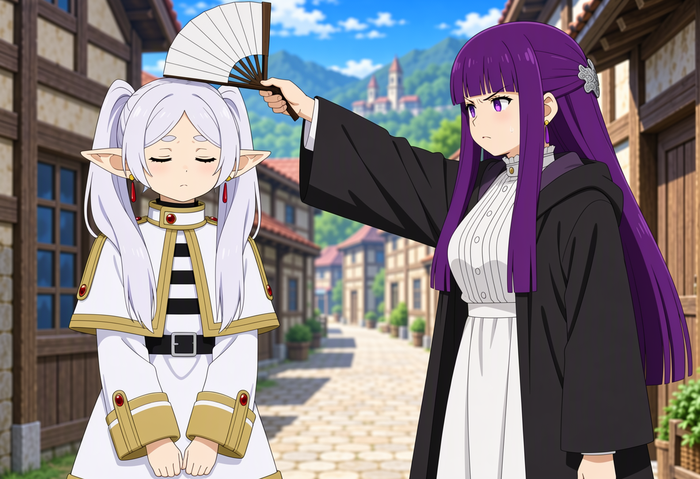
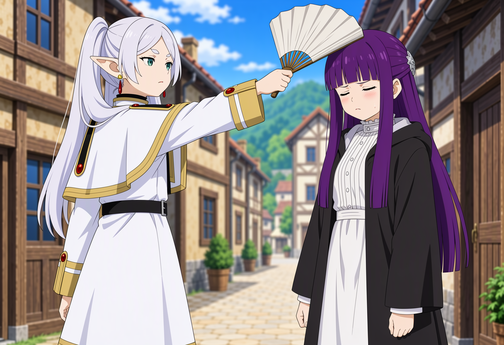
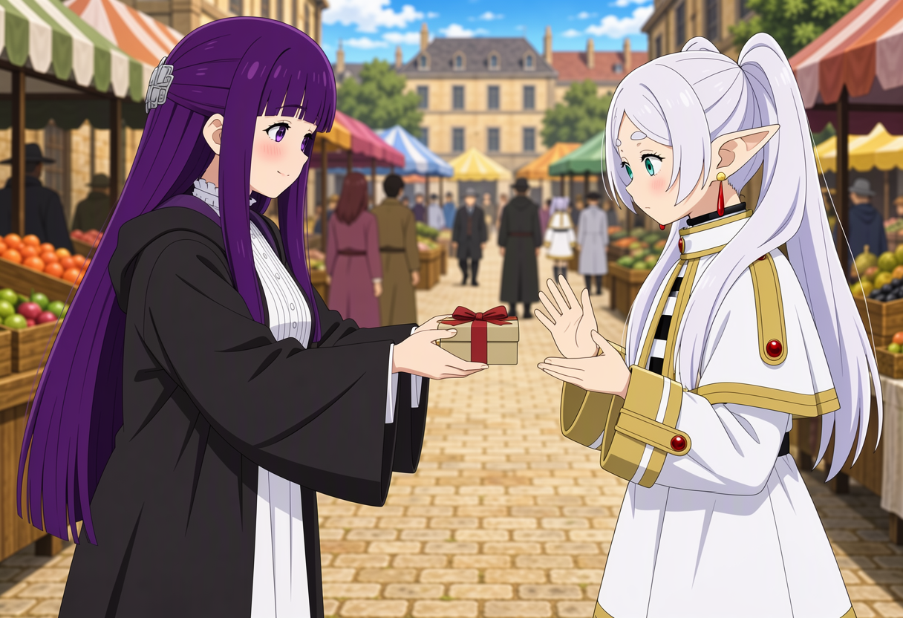
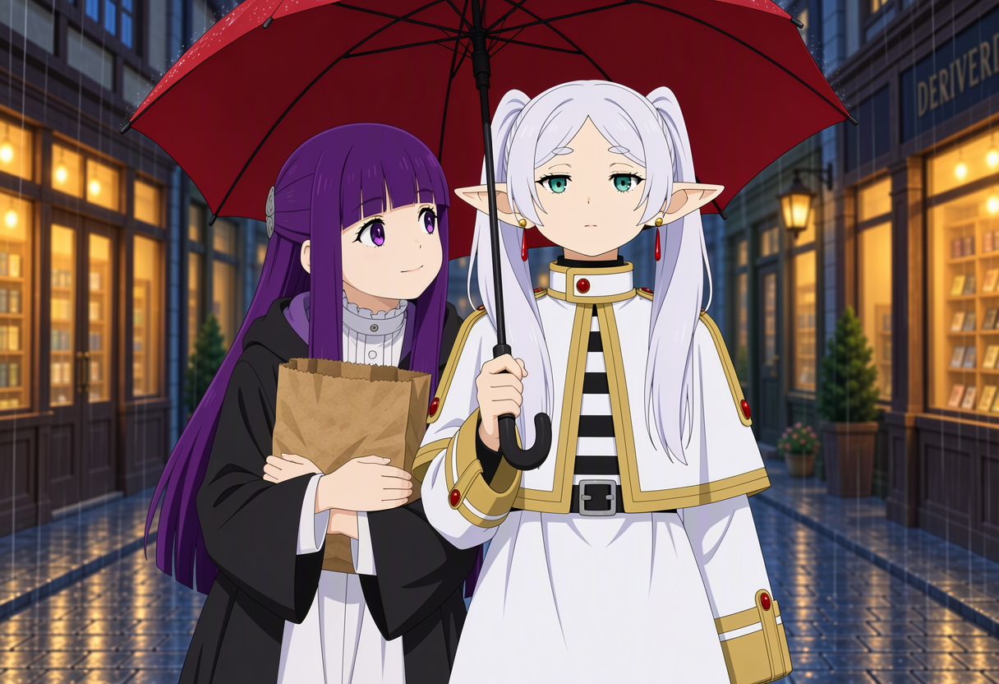
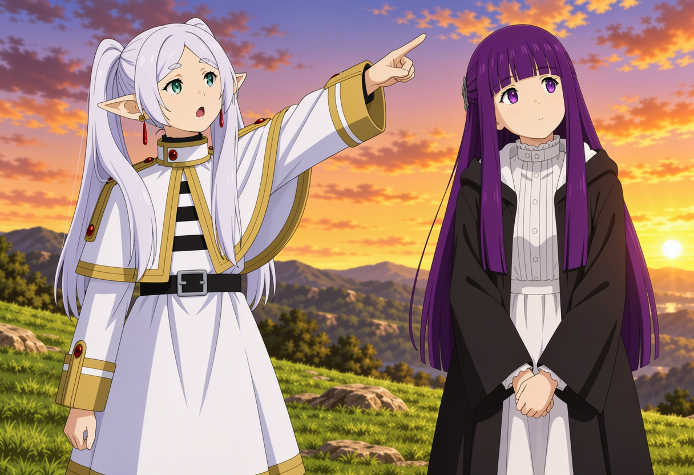
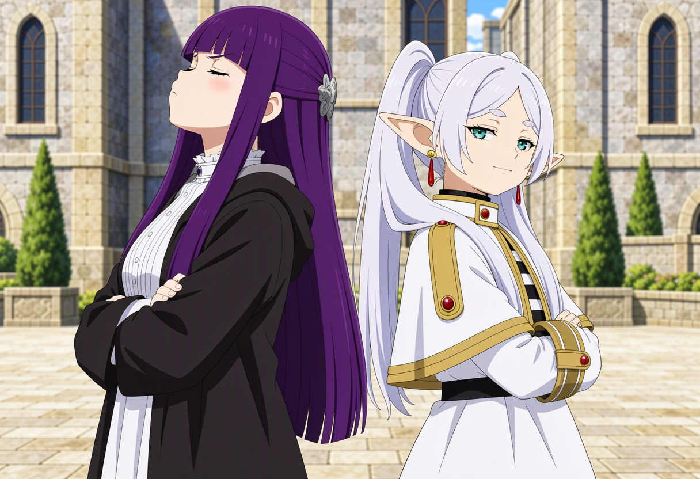

# Actor-ID prompting for MOSS-Image

A prompting technique for [MOSS-Image](https://huggingface.co/OpenMOSS-Team) (5B DiT) that makes it bind actions to numbered actors (`A1`, `A2`) instead of character names, so the same action can be reused with any cast.

The examples below are from the Frieren cast, with every prompt in the same format.

For the official guide to MOSS-Image, see [USERGUIDE.md](https://github.com/OpenMOSS/MOSS-Image/blob/2b46b1e0e13b5aaec253879e0d006a42564b8b27/USERGUIDE.md) (pinned to commit `2b46b1e`).

## The technique

A prompt has two sections, in this order:

1. **Cast section:** each actor once, with an ID, the name and the look cues.
2. **Action section:** what each actor does, referred to only by ID. No names, no hair, eyes or outfit.

```
Anime illustration, a comedic scene from Frieren: Beyond Journey's End.
Fern (A1) (Fern from Frieren, long dark purple hair with straight bangs, purple eyes, white mage robes) and Frieren (A2) (Frieren from Frieren, long silver-white twin tails, pointed elf ears, green eyes, white mage coat).

<action section>
<setting and camera line>
```

Why it works:

- **The action section carries no identity,** so it can be appended to any cast section. A scene becomes a template.
- **Roles are bound by ID.** Swapping `A1` and `A2` in the action section swaps who does what. The same girl does not end up holding the prop in both versions.
- **Each actor gets their own sentence,** with position, pose and expression, and one sentence states who holds each object.

Rules for the action section:

- Refer to actors only by ID.
- Give every actor a position (left, right, center), a pose and an expression.
- State who holds each object, and that the other actor's hands are empty or doing something else.
- Describe the relationship as one direct action ("A1 swings a fan down onto the head of A2").
- End with the setting and a camera line that says all actors are visible.

Positions should be relative to the frame ("on the left of the frame"), not to an actor ("on her left"). The model reads "her left" ambiguously.

## Scenarios

All six use the same cast section above, with only the action section changed. The original test runs used seed 31337, 30 steps, CFG 3, 1216×832, and the workflow's quality prefix (`masterpiece, best quality, amazing quality, absurdres,`). Each scenario is one seed, so expect small run-to-run differences.

### 1. Paper fan strike



Fern (A1) on the right scowls and presses a paper fan onto Frieren's head. Frieren (A2) on the left has her eyes shut, a sweat drop and empty hands.

```
A1 stands on the right, scowling, and swings a white paper fan (harisen) down onto the head of A2. A2 stands on the left, eyes shut, flinching slightly, with an unbothered, sulky expression. A1 is the one holding the fan; A2's hands are empty.
Bright daytime village street, medium shot, both characters fully visible.
```

Prompt example: [civitai.red/images/147483850](https://civitai.red/images/147483850)

### 2. Role reversal



The same scene with the IDs swapped. Frieren (A2) on the left scowls and presses the fan onto Fern's head. Fern (A1) on the right has her eyes shut, a sweat drop and empty hands. Only the IDs changed.

```
A2 stands on the left, scowling, and swings a white paper fan (harisen) down onto the head of A1. A1 stands on the right, eyes shut, flinching slightly, with an unbothered, sulky expression. A2 is the one holding the fan; A1's hands are empty.
Bright daytime village street, medium shot, both characters fully visible.
```

Prompt example: [civitai.red/images/147483851](https://civitai.red/images/147483851)

### 3. Handing over a gift



Fern (A1) on the left smiles shyly and holds a wrapped box out with both hands. Frieren (A2) on the right has wide eyes and half-raised empty hands.

```
A1 stands on the left, smiling shyly, and holds out a small wrapped box with both hands toward A2. A2 stands on the right, looking down at the box with wide eyes and her hands half-raised to take it. A1 is the one holding the box; A2's hands are empty and open.
Warm afternoon market square, medium shot, both characters fully visible.
```

Prompt example: [civitai.red/images/147483854](https://civitai.red/images/147483854)

### 4. Sharing an umbrella in the rain



Frieren (A2) holds a red umbrella over both of them, calm and bored. Fern (A1) hugs a paper bag and looks up with a small smile.

```
A2 stands in the center, holding a large red umbrella over both of them with her right hand, and looks straight ahead with a calm, slightly bored expression. A1 stands close on her left, shoulder to shoulder with A2, hugging a paper bag against her chest and glancing up at A2 with a small smile. A2 is the only one holding the umbrella; A1's hands are wrapped around the bag.
Rainy evening street with wet cobblestones and glowing shop windows, medium shot, both characters fully visible.
```

Caveat: "her left" was ambiguous here. Fern ended up on the viewer's left, which is Frieren's right. The prompt above keeps the original wording, but for new prompts use frame-relative positions.

Prompt example: [civitai.red/images/147483855](https://civitai.red/images/147483855)

### 5. Pointing off-screen



Frieren (A2) on the left points up and to the right, mouth open. Fern (A1) on the right looks the same way with her hands clasped. The thing she points at is outside the frame.

```
A2 stands on the left, pointing with her right arm toward the upper right of the frame, mouth slightly open in surprise. A1 stands on the right, looking where A2 points with her head tilted and her hands clasped in front of her. A2 is the one pointing; A1's hands hold nothing.
Grassy hilltop at sunset, medium shot, both characters fully visible, the pointed-at object outside the frame.
```

Prompt example: [civitai.red/images/147483857](https://civitai.red/images/147483857)

### 6. Back to back, arms crossed



Both have crossed arms and stand with their backs together. Fern (A1) faces left with closed eyes and a pout. Frieren (A2) faces right with a sideways glance and a faint smirk.

```
A1 and A2 stand back to back in the center, both with their arms crossed. A1 faces the left of the frame, eyes closed and chin raised in a pout. A2 faces the right of the frame, glancing sideways at A1 with a sly smirk. Neither holds anything.
Sunlit stone courtyard, medium wide shot, both characters fully visible.
```

Prompt example: [civitai.red/images/147483858](https://civitai.red/images/147483858)

## Limitations

- **One seed per scenario.** The images show the technique works in these cases, not that it succeeds every time.
- **Fine contact details are weaker than roles.** Who holds what and who does what are reliable. A small contact point (a head tilt in the pointing scenario) is not.
- **Outfit colour drifts.** Fern's outer robe came out black in some runs and beige in others, because the cast line only says "white mage robes".
- **Not tested with other characters.** Using IDs with original characters, without names, is untested.
